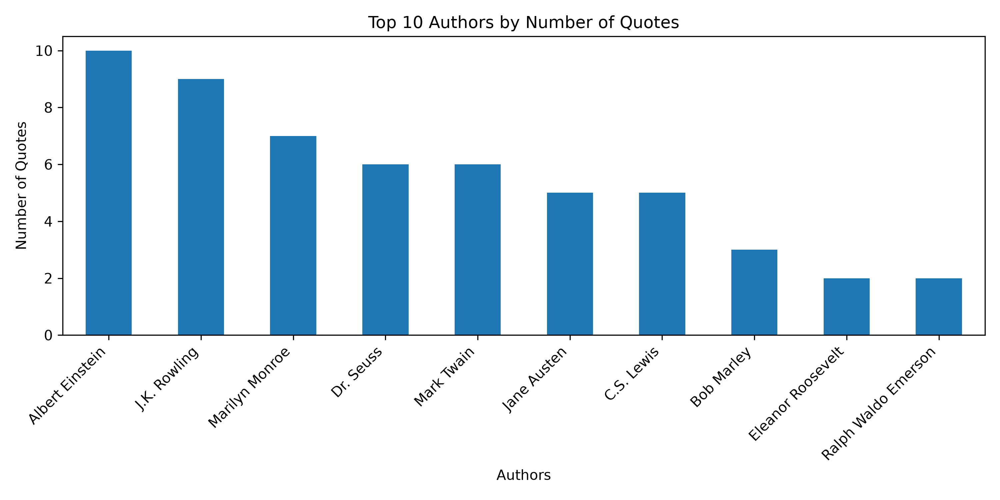

# Python Web Scraping & Quotes Analysis

A Python-based web scraping project using **Requests** and **BeautifulSoup** to extract quotes and author information from [Quotes to Scrape](https://quotes.toscrape.com/). The project collects data across multiple pages, exports it to CSV, and performs basic data analysis and visualization using Pandas and Matplotlib.

---

## Features

- Scrapes quotes and author names from web pages.
- Automatically navigates through multiple pages.
- Extracts a dataset of **100 quotes**.
- Saves extracted data in CSV format.
- Checks for missing values and duplicate records.
- Analyzes quote frequency by author.
- Visualizes the top 10 authors using a bar chart.
- Supports keyword-based quote searching.
- Supports author searching with partial name matching.
- Uses reusable Python functions for scraping and searching.

---

## Project Structure

```text
Python_Quotes_Web_Scraping/
│
├── Web_Scraping_Practice.ipynb   # Main Jupyter Notebook
├── final_quotes_dataset.csv     # Extracted quotes dataset
├── top_10_authors.png           # Author frequency chart
└── README.md                    # Project documentation
```

---

## Installation & Usage

**1. Install the required dependencies:**

```bash
pip install pandas requests beautifulsoup4 matplotlib notebook
```

**2. Launch Jupyter Notebook:**

```bash
jupyter notebook
```

**3. Open the project notebook:**

`Web_Scraping_Practice.ipynb`

Run the cells in order to explore the scraping process, data analysis, and search features.

---

## Example Output

The extracted data is saved in `final_quotes_dataset.csv`.

| Quote | Author |
|---|---|
| Example extracted quote... | Albert Einstein |
| Another extracted quote... | J.K. Rowling |

**Dataset Summary:**

- Total records: 100
- Missing values: 0
- Duplicate records: 0

---

## Data Visualization

The project generates a bar chart showing the top 10 authors based on their quote frequency.



---

## Technologies Used

- **Python 3**
- **Requests** — HTTP requests
- **BeautifulSoup4** — HTML parsing and data extraction
- **Pandas** — Data processing and analysis
- **Matplotlib** — Data visualization
- **Jupyter Notebook** — Development environment

---

## Data Source

[Quotes to Scrape](https://quotes.toscrape.com/) — A website designed for practicing web scraping.

---

## Project Purpose

This project was developed as a hands-on learning exercise to strengthen Python programming, web scraping, data processing, and visualization skills.

---

**Developed by [Saqlain Mushtaq](https://github.com/saqlainsaqlain625)**